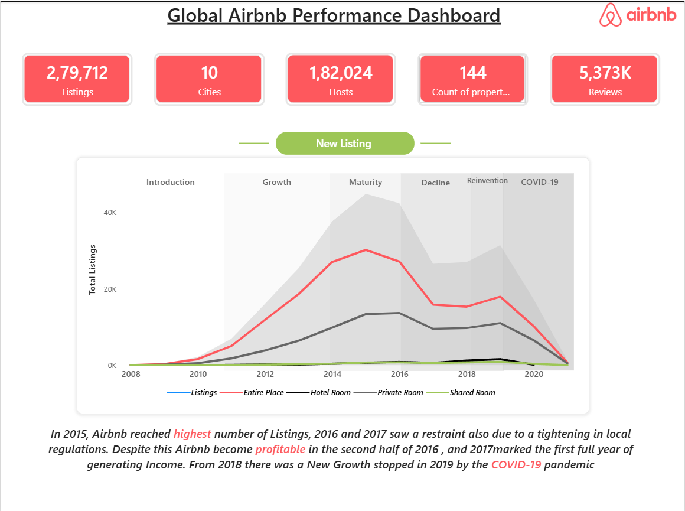
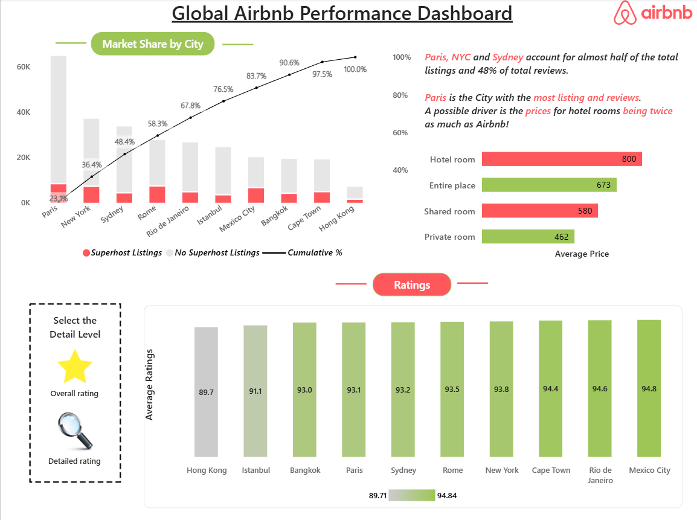
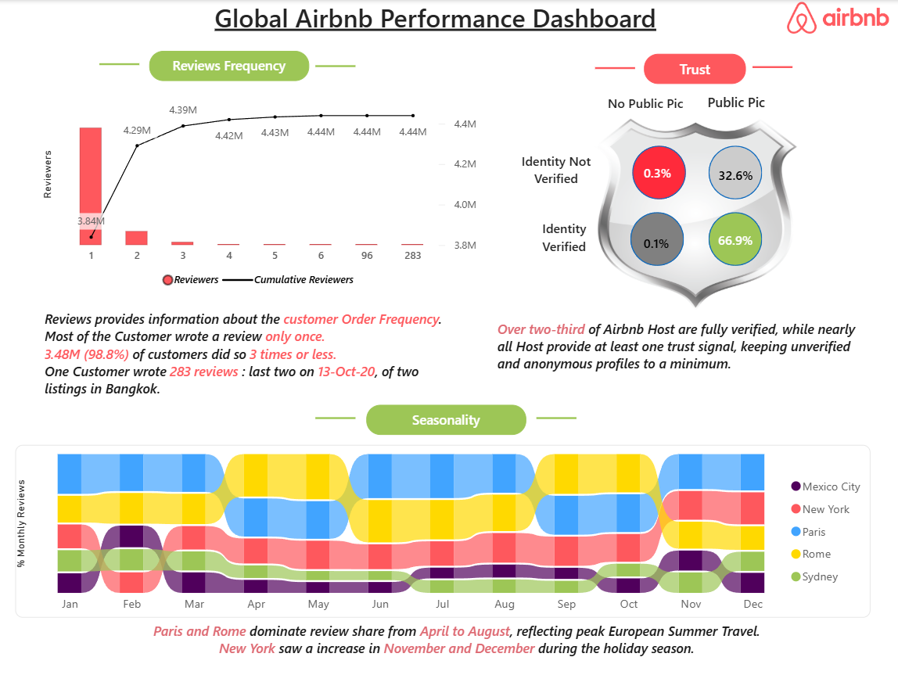

# Power-BI-Airbnb-Dashboard-Project
Analyzed Global Airbnb Performance using Power BI, exploring listing growth, city market share, property prices, customer reviews, host trust, ratings, and seasonality. Developed interactive dashboards to identify market trends, understand customer behavior, and generate data-driven business insights.

# 🏠 Global Airbnb Performance Dashboard

An interactive **Power BI** dashboard that analyzes Airbnb's global performance
across **10 major cities**, covering listing growth, market share, pricing,
guest ratings, review behavior, host trust, and seasonality.


```
Power-BI-Airbnb-Dashboard-Project/
│
├── Assets
├── Dashboard/
│   └── (Google Drive Link)
├── Datasets/
│   └── (Google Drive Link)
├── Docs/
│   ├── Airbnb_Project_Power_BI_Final.pdf
│   ├── Dashboard_Information.pdf 
├── Images/
│   ├── page01_Overview.png
│   ├── page02_Market_Ratings.png
│   └── page03_Reviews_Trust_Seasonality.png
└── README
```
---

## 📌 Project Overview

This project explores a global Airbnb dataset to understand how the platform
grew, where demand is concentrated, and how hosts and guests behave.
The dashboard is designed to help stakeholders quickly identify trends,
top-performing cities, and seasonal patterns.

## 📊 Key Metrics

| Metric | Value |
|--------|-------|
| Total Listings | 279,712 |
| Cities | 10 |
| Hosts | 182,024 |
| Property Types | 144 |
| Total Reviews | 5,373K |

## 🔍 Key Insights

### 1. Listing Growth (Lifecycle Analysis)
- Listings moved through six phases: **Introduction → Growth → Maturity →
  Decline → Reinvention → COVID-19**.
- Airbnb hit its **peak listings in 2015**, followed by a slowdown in
  2016–2017 due to tighter local regulations.
- New growth emerged from 2018 before being halted by **COVID-19**.
- **Entire Place** is the dominant room type, followed by Private Room.

### 2. Market Share by City
- **Paris, New York and Sydney** account for almost half of all listings
  (cumulative 48.4%) and 48% of total reviews.
- **Paris** has the most listings and reviews. A possible driver: hotel
  room prices are about twice as high as Airbnb.
- A Pareto (cumulative %) view shows the top 5 cities make up ~68% of listings.

### 3. Pricing
- Average price by room type: Hotel Room (800), Entire Place (673),
  Shared Room (580), Private Room (462).

### 4. Ratings
- **Mexico City (94.8)**, **Rio de Janeiro (94.6)** and **Cape Town (94.4)**
  rank highest.
- **Hong Kong (89.7)** has the lowest average rating.
- Users can toggle between *Overall* and *Detailed* ratings.

### 5. Review Behavior
- Most reviewers wrote only **one review**; **98.8% (3.48M)** wrote 3 or fewer.
- One outlier reviewer wrote **283 reviews** for two Bangkok listings.

### 6. Host Trust
- **66.9%** of hosts are identity-verified with a public profile picture.
- Only **0.3%** have neither verification nor a public picture.

### 7. Seasonality
- **Paris and Rome** dominate review share from **April–August**
  (European summer travel).
- **New York** peaks in **November–December** (holiday season).

## 🛠️ Tools & Technologies

- **Power BI Desktop**: dashboard design & interactivity
- **Power Query**: data cleaning and transformation
- **DAX**: calculated measures (cumulative %, ranking, etc.)
- **Data Modeling**: relationships between listings, hosts and reviews

## 📈 Dashboard Features

- KPI cards for quick performance snapshots
- Lifecycle area/line chart with market phases
- Pareto chart (market share + cumulative %)
- Interactive rating toggle (Overall vs. Detailed)
- Sankey/ribbon chart for seasonality
- Trust matrix (identity verification × public picture)

## 📸 Dashboard Preview

### Page 1: Listing Growth


### Page 2: Market Share, Pricing & Ratings


### Page 3: Reviews, Trust & Seasonality

---

## 🧹 Data Cleaning & Preparation

Performed in Power Query:

1. **Imported** listings, hosts, and reviews tables
2. **Removed duplicates** on listing ID and host ID
3. **Handled missing values** in price, ratings, and host fields
4. **Corrected data types** (dates, whole numbers, decimals, text)
5. **Standardized text** (city names, room types) using Trim and Proper Case
6. **Extracted date parts** (Year, Month, Month Name) from listing and
   review dates for lifecycle and seasonality analysis
7. **Created a Date table** for time intelligence
8. **Filtered outliers** in price where unrealistic
9. **Merged/appended** tables where needed

---

## 🧮 Key DAX Measures

**Total Listings**
```dax
Total Listings = COUNTROWS(Listings)
```

**Total Hosts**
```dax
Total Hosts = DISTINCTCOUNT(Listings[host_id])
```

**Total Reviews**
```dax
Total Reviews = COUNTROWS(Reviews)
```

**Average Price**
```dax
Avg Price = AVERAGE(Listings[price])
```

**Average Rating**
```dax
Avg Rating = AVERAGE(Listings[review_scores_rating])
```

**Superhost Listings**
```dax
Superhost Listings =
CALCULATE(
    [Total Listings],
    Hosts[is_superhost] = TRUE()
)
```

**Cumulative % (Pareto chart)**
```dax
Cumulative % =
VAR CurrentListings = [Total Listings]
VAR AllCities = ALLSELECTED(Listings[city])
VAR RunningTotal =
    SUMX(
        FILTER(AllCities, [Total Listings] >= CurrentListings),
        [Total Listings]
    )
RETURN
DIVIDE(RunningTotal, CALCULATE([Total Listings], ALLSELECTED(Listings[city])))
```

**% Monthly Reviews (Seasonality)**
```dax
% Monthly Reviews =
DIVIDE(
    [Total Reviews],
    CALCULATE([Total Reviews], ALLSELECTED(Date[Month]))
)
```

**Reviews per Reviewer (Review Frequency)**
```dax
Reviewers = DISTINCTCOUNT(Reviews[reviewer_id])
```
---
## 🌟 About me
Hey, I am Mohammed Abdul Qader
I am an aspiring Data Analyst with a strong interest in Dashboarding, Data Warehousing, and Data-Driven decision-making. This project demonstrates my ability to transform data into interactive dashboards, identify meaningful trends, and communicate actionable business insights through data-driven storytelling. I am passionate about learning new technologies and transforming raw data into meaningful business insights.
